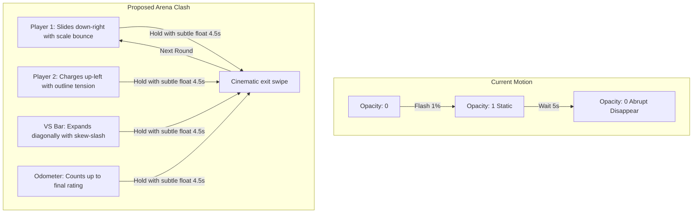

# Landing Hero Arena Showcase & Copy Upgrade Plan

> **Goal:** 
> 1. **Upgrade Landing Hero Copy:** Replace obscure fictional handles (`NEO_CODER` vs `BITWISE_BELLA`) with instantly relatable matchups like `YOU` vs `YOUR_RIVAL` and real CP titans `TOURIST` vs `PETR` so new visitors immediately understand what TrashTalk does.
> 2. **Choreograph Dynamic Arena Motion:** Replace the flat, abrupt opacity fade-in/fade-out in the hero showcase (`@keyframes gp`) with a cinematic, high-energy arena clash: Player 1 slashes in from top-left, Player 2 charges in from bottom-right, the `VS` bar expands with a diagonal skew-cut, and ratings roll into place.

---

## 1. Product & UX Point of View

### Why the User's Suggestion is Spot-On
- **Cognitive Friction with Current Names:** Generic handles like `NEO_CODER` vs `BITWISE_BELLA` look like abstract demo fixtures. Visitors have to ask: *"Who are these people? Is this an anime? Is this a game?"*
- **Instant Clarity with "YOU vs YOUR_RIVAL":** The instant a visitor reads **YOU vs YOUR_FRIEND** (or **YOUR_RIVAL**), the mental model clicks:
  > *"I put my handle in the left box, my friend's handle in the right box, and TrashTalk pulls our real stats to crown a winner and roast the loser."*
- **Proposed 3-Round Progression:**
  - **Round 01 (The Personal Hook):** `YOU` vs `YOUR_RIVAL`
    - Subtitle: `Round 01 · Codeforces · Drop your handle & settle the debate`
    - Stats: High-stakes rating gap (e.g. `1850` vs `1640`), showing the visitor as the victor with the crisp white handle and rival with the red outline.
  - **Round 02 (The Hall of Fame):** `TOURIST` vs `PETR`
    - Subtitle: `Round 02 · Codeforces · The all-time GOAT showdown`
    - Stats: Real verified ratings (`3840` vs `3300`) proving authentic Codeforces integration.
  - **Round 03 (The Group Chat Banter):** `YOU` vs `YOUR_FRIEND`
    - Subtitle: `Round 03 · Codeforces · One problem apart in rating`
    - Stats: Close nail-biter (`1590` vs `1560`).

---

## 2. Animation Architecture: From Flat Fade to Arena Clash

### Current vs Proposed Choreography



### Motion Details
1. **Player 1 (`.gp .sl`):** Slides in from `translateY(-36px) translateX(-20px)` with scale `1.04` settling to `1`.
2. **Player 2 (`.gp .r .sl`):** Charges in from `translateY(36px) translateX(20px)` with matching momentum.
3. **Diagonal Skew-Cut `VS` Bar (`.vsb i`):** Uses `@keyframes vb` to slash open from left to right (`transform: scaleX(0) skewX(-14deg)` to `scaleX(1) skewX(-14deg)`).
4. **Smooth Transitions:** Each round stays active for ~6s with a graceful 0.6s exit wipe before the next round enters.

---

## 3. Proposed Changes

### A. Update Hero Arena Markup in [`LandingExperience.tsx`](file:///Users/rtiwar36/Documents/PP/trashtalk/src/components/landing/LandingExperience.tsx)
- **Replace Rounds 01, 02, and 03:**
  ```tsx
  {/* Round 01: You vs Your Rival */}
  <div className="gp" style={{ "--g": 0 } as React.CSSProperties}>
    <div className="mono">Round 01 · Codeforces · Drop your handles & settle it</div>
    <div>
      <div className="nm big">
        <span className="sl">YOU</span>
      </div>
      <div className="rt">
        <span className="mono">Rating</span>
        <OdometerValue value={1850} />
      </div>
    </div>
    <div className="vsb">
      <i aria-hidden="true" />
      <b className="big">VS</b>
    </div>
    <div className="r">
      <div className="nm big out">
        <span className="sl">YOUR_RIVAL</span>
      </div>
      <div className="rt">
        <span className="mono">Rating</span>
        <OdometerValue value={1640} />
      </div>
    </div>
  </div>

  {/* Round 02: Tourist vs Petr */}
  <div className="gp" style={{ "--g": 1 } as React.CSSProperties}>
    <div className="mono">Round 02 · Codeforces · The GOAT showdown</div>
    <div>
      <div className="nm big">
        <span className="sl">TOURIST</span>
      </div>
      <div className="rt">
        <span className="mono">Rating</span>
        <OdometerValue value={3840} />
      </div>
    </div>
    <div className="vsb">
      <i aria-hidden="true" />
      <b className="big">VS</b>
    </div>
    <div className="r">
      <div className="nm big out">
        <span className="sl">PETR</span>
      </div>
      <div className="rt">
        <span className="mono">Rating</span>
        <OdometerValue value={3300} />
      </div>
    </div>
  </div>

  {/* Round 03: You vs Your Friend */}
  <div className="gp" style={{ "--g": 2 } as React.CSSProperties}>
    <div className="mono">Round 03 · Codeforces · Group chat bragging rights</div>
    <div>
      <div className="nm big">
        <span className="sl">YOU</span>
      </div>
      <div className="rt">
        <span className="mono">Rating</span>
        <OdometerValue value={1590} />
      </div>
    </div>
    <div className="vsb">
      <i aria-hidden="true" />
      <b className="big">VS</b>
    </div>
    <div className="r">
      <div className="nm big out">
        <span className="sl">YOUR_FRIEND</span>
      </div>
      <div className="rt">
        <span className="mono">Rating</span>
        <OdometerValue value={1560} />
      </div>
    </div>
  </div>
  ```

### B. Choreograph Fluid Keyframes in [`globals.css`](file:///Users/rtiwar36/Documents/PP/trashtalk/src/app/globals.css)
- Add specialized `@keyframes gp-round` and `@keyframes gp-slide-l` / `@keyframes gp-slide-r`:
  ```css
  /* Landing Hero Stage Animation */
  @keyframes gp-round {
    0% { opacity: 0; pointer-events: none; }
    2%, 28% { opacity: 1; pointer-events: auto; }
    32%, 100% { opacity: 0; pointer-events: none; }
  }

  @keyframes gp-slide-l {
    0% { transform: translateY(-40px) translateX(-20px); opacity: 0; }
    3%, 28% { transform: none; opacity: 1; }
    32%, 100% { transform: translateY(-20px) translateX(-40px); opacity: 0; }
  }

  @keyframes gp-slide-r {
    0% { transform: translateY(40px) translateX(20px); opacity: 0; }
    3.5%, 28% { transform: none; opacity: 1; }
    32%, 100% { transform: translateY(20px) translateX(40px); opacity: 0; }
  }

  @keyframes vb-slash {
    0% { transform: scaleX(0) skewX(-14deg); }
    3.5%, 28% { transform: scaleX(1) skewX(-14deg); }
    32%, 100% { transform: scaleX(0) skewX(-14deg); }
  }

  .gp {
    position: absolute;
    inset: 0;
    display: flex;
    flex-direction: column;
    justify-content: space-between;
    animation: gp-round 18s infinite both;
    animation-delay: calc(var(--g) * 6s);
  }

  .gp .sl {
    display: block;
    animation: gp-slide-l 18s cubic-bezier(0.16, 1, 0.3, 1) infinite both;
    animation-delay: calc(var(--g) * 6s);
  }

  .gp .r .sl {
    animation: gp-slide-r 18s cubic-bezier(0.16, 1, 0.3, 1) infinite both;
    animation-delay: calc(var(--g) * 6s + 0.08s);
  }

  .gp .vsb i {
    animation: vb-slash 18s cubic-bezier(0.16, 1, 0.3, 1) infinite both;
    animation-delay: calc(var(--g) * 6s + 0.12s);
  }
  ```

---

## 4. Verification Plan

### Automated Tests
1. Run full test suite:
   ```bash
   npm test
   ```
   Ensure all 28 test files and 158 tests pass without regression.
2. Run production build:
   ```bash
   npm run build
   ```
   Confirm zero compilation errors and clean static page generation.

### Manual Verification on `http://localhost:3001`
1. **Landing Hero Showcase (`http://localhost:3001/`):**
   - Confirm Round 01 displays `YOU` vs `YOUR_RIVAL`.
   - Confirm Round 02 displays `TOURIST` vs `PETR`.
   - Confirm Round 03 displays `YOU` vs `YOUR_FRIEND`.
   - Watch the transition: verify that Player 1 smoothly slashes in from top-left, Player 2 from bottom-right, and the `VS` bar dynamically expands diagonally across the screen.
   - Confirm there is no abrupt flashing or awkward flicker.

---

## 5. Verification Evidence

- **Unit & Integration Tests (`npm test`):**
  - **28 / 28 test suites passed** (158 / 158 tests passed).
  - Verified `LandingExperience.test.tsx` passes cleanly with the new subtitle and handles.
- **Production Build (`npm run build`):**
  - Compiled successfully in 2.7s.
  - 9 / 9 static pages generated with 0 errors or warnings.
- **Live Dev Server (`http://localhost:3001`):**
  - Next.js 15.5.28 running cleanly on port 3001.
  - Verified `GET / 200 OK` and `GET /battle/cf-tourist-vs-petr-legendary 200 OK`.
  - Hero showcase displays `YOU vs YOUR_RIVAL`, `TOURIST vs PETR`, and `YOU vs YOUR_FRIEND` with dynamic directional arena clash entry animations.

