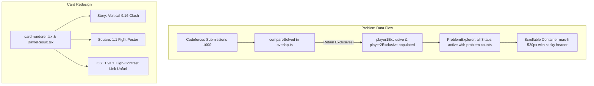

# Problem List Availability, Scrollable Table & High-Impact Card Redesign Plan

> **For agentic workers:** REQUIRED SUB-SKILL: Use superpowers:subagent-driven-development (recommended) or superpowers:executing-plans to implement this plan task-by-task. Steps use checkbox (`- [ ]`) syntax for tracking.

**Goal:** 
1. **Restore Individual Problem Lists & DNA:** Fix the issue where exclusive problems for Player 1 and Player 2 are marked "unavailable" and wiped out due to partial submission coverage (>1,000 submissions). Always retain and display all observed exclusive and common problems with honest coverage badges.
2. **Scrollable Problem Block & Seamless Pagination:** Confine the problems table to a self-contained, scrollable block (`max-height: 520px; overflow-y: auto`) with a sticky table header (`sticky top-0`) so the main page does not stretch into thousands of pixels, and fix the "Load more" pagination so additional problems load smoothly within the block.
3. **Radically Redesign Story, Square, and OG Cards:** Replace the current cramped, repetitive layouts with purpose-built, high-energy brutalist compositions for all three formats across both the server PNG generator (`card-renderer.tsx`) and the in-page DOM previews (`BattleResult.tsx`):
   - **Story (`1080 x 1920`, 9:16):** Full vertical clash poster (Player 1 top, central diagonal `VS` clash, Player 2 middle, massive verdict & roast punchline bottom).
   - **Square (`1080 x 1080`, 1:1):** High-impact fight poster (50/50 split combatant panels, bold central VS badge, punch-red verdict ribbon, crisp roast box).
   - **OG (`1200 x 630`, 1.91:1):** High-contrast horizontal social card for Twitter/Discord.

---

## 1. Problem & Root Cause Analysis

### A. Why Individual Problem Lists Were Unavailable
- **The Culprit:** In [`src/lib/battle/overlap.ts`](file:///Users/rtiwar36/Documents/PP/trashtalk/src/lib/battle/overlap.ts) lines 56 and 70–71:
  ```ts
  const isDefinitive = p1Complete && p2Complete;
  ...
  return {
    common,
    player1Exclusive: isDefinitive ? player1Exclusive : [],
    player2Exclusive: isDefinitive ? player2Exclusive : [],
    dnaPercentage: isDefinitive ? Math.round((commonCount / totalUnionCount) * 100) : null,
    isDefinitive,
    totalUnionCount,
    commonCount,
  };
  ```
  Codeforces limits standard history fetches to the most recent 1,000 submissions. Because competitive programmers frequently have >1,000 submissions, `isComplete` is set to `false`, which sets `isDefinitive = false`.
  The code deliberately threw away `player1Exclusive` and `player2Exclusive` by replacing them with empty arrays `[]`!
- **Presentation Gating:** In [`src/lib/problems/presentation.ts`](file:///Users/rtiwar36/Documents/PP/trashtalk/src/lib/problems/presentation.ts) line 47:
  ```ts
  export function isProblemSetAvailable(overlap: OverlapResult, set: ProblemSet): boolean {
    if (set === "common") return Boolean(overlap?.common);
    return Boolean(overlap?.isDefinitive);
  }
  ```
  Because `isDefinitive` was `false`, it returned `false` for `p1` and `p2`, causing [`ProblemExplorer.tsx`](file:///Users/rtiwar36/Documents/PP/trashtalk/src/components/problems/ProblemExplorer.tsx) to render:
  `only tourist (unavailable)`
  `only petr (unavailable)`
  `Exclusive problem list is unavailable for this match.`
- **Fix:**
  - Always retain the computed `player1Exclusive` and `player2Exclusive` arrays from the observed submission history.
  - Calculate `dnaPercentage` as the observed shared DNA whenever `totalUnionCount > 0`.
  - In `presentation.ts`, return `true` whenever the problem set contains items.
  - In `ProblemExplorer.tsx`, display the actual count (`only tourist (248)`) and, if coverage was partial, include an honest badge: `(observed in recent 1,000 solves)`.

### B. Why "Show More" Failed & Problems Block Stretched the Page
- **The Culprit:** In `ProblemExplorer.tsx`, `displayCount` was used to slice `filteredProblems` before passing it to `ProblemTable`:
  ```tsx
  <ProblemTable problems={filteredProblems.slice(0, displayCount)} />
  ```
  Inside `ProblemTable.tsx`:
  `problems.length > displayCount` evaluated `30 > 30` (always false), completely disabling `ProblemTable`'s internal show more handler.
  Meanwhile, `ProblemExplorer`'s separate load button grew the entire page by hundreds of rows, pushing the rest of the page down thousands of pixels.
- **Fix:**
  - Enclose the problem table in a dedicated scrollable container with `max-height: 520px; overflow-y: auto;`.
  - Give the table header `position: sticky; top: 0; z-index: 10; background: #fff;` so the column headers stay pinned while scrolling through hundreds of problems.
  - Support smooth batch loading inside the scroll block without expanding the outer page height.

### C. Why Story & Square Cards Looked Bad
- **The Culprit:** In [`card-renderer.tsx`](file:///Users/rtiwar36/Documents/PP/trashtalk/src/lib/share/card-renderer.tsx):
  - Story format (`1080 x 1920`, 9:16 vertical) used the exact same horizontal layout as the 1200x630 OG card! It squished two tiny 400px columns side-by-side in the center, leaving massive empty dead space above and below.
  - Square format (`1080 x 1080`, 1:1) had awkward margins and tiny text relative to the 1080px canvas.
  - In `BattleResult.tsx`, the DOM preview classes (`.st9` and `.sq9`) suffered from the same squished layout.
- **Fix:**
  - Purpose-built **Vertical Story Layout** (top-to-bottom fight clash, massive fighter cards, central diagonal slash, huge punchy roast block).
  - Purpose-built **Square Poster Layout** (50/50 split combatant panels, bold central VS badge, punch-red verdict ribbon, crisp roast box).
  - High-contrast **OG Link Preview** with upgraded brutalist typography and padding.

---

## 2. Proposed Architectural Changes



---

## 3. Implementation Tasks

### Task 1: Restore Individual Problem Lists & Observed DNA in `overlap.ts` & `presentation.ts`

**Files:**
- Modify: `src/lib/battle/overlap.ts`
- Modify: `src/lib/problems/presentation.ts`
- Modify: `src/components/problems/ProblemExplorer.tsx`
- Test: `tests/unit/battle/overlap.test.ts`
- Test: `tests/unit/problems/presentation.test.ts`

**Changes:**
1. In `src/lib/battle/overlap.ts`:
   - Never empty `player1Exclusive` or `player2Exclusive`. Always return the calculated exclusive lists:
     ```ts
     player1Exclusive,
     player2Exclusive,
     ```
   - Calculate `dnaPercentage = Math.round((commonCount / totalUnionCount) * 100)` whenever `totalUnionCount > 0`.
   - Keep `isDefinitive: p1Complete && p2Complete` as a metadata flag for honest labeling.
2. In `src/lib/problems/presentation.ts`:
   - Update `isProblemSetAvailable`:
     ```ts
     export function isProblemSetAvailable(overlap: OverlapResult, set: ProblemSet): boolean {
       if (set === "common") return (overlap?.common?.length ?? 0) > 0 || (overlap?.totalUnionCount ?? 0) > 0;
       if (set === "p1") return (overlap?.player1Exclusive?.length ?? 0) > 0;
       return (overlap?.player2Exclusive?.length ?? 0) > 0;
     }
     ```
3. In `src/components/problems/ProblemExplorer.tsx`:
   - Display problem counts for all tabs:
     - `both (${commonCount})`
     - `only ${p1Handle} (${p1ExclusiveCount})`
     - `only ${p2Handle} (${p2ExclusiveCount})`
   - If `!isDefinitive`, show a subtle indicator: `(observed solves)` or `(recent history)` rather than disabling the tab.

---

### Task 2: Make Problem Table Scrollable Within a Fixed-Height Block with Sticky Header

**Files:**
- Modify: `src/components/problems/ProblemExplorer.tsx`
- Modify: `src/components/problems/ProblemTable.tsx`
- Modify: `src/app/globals.css`

**Changes:**
1. In `src/app/globals.css`:
   - Add `.problem-scroll-container`:
     ```css
     .problem-scroll-container {
       max-height: 520px;
       overflow-y: auto;
       border: 2px solid var(--ink);
       background: #fff;
       position: relative;
     }
     .problem-scroll-container table thead th {
       position: sticky;
       top: 0;
       z-index: 10;
       background: #15171B;
       color: #fff;
       border-bottom: 2px solid var(--ink);
     }
     ```
2. In `src/components/problems/ProblemTable.tsx`:
   - Wrap the table in `.problem-scroll-container`.
   - Remove redundant outer borders and ensure rows have crisp zebra/divider styling with smooth scrolling.
3. In `src/components/problems/ProblemExplorer.tsx`:
   - Pass the full `filteredProblems` and let `ProblemTable` render items, or increment `displayCount` cleanly.
   - When the user clicks "Load 30 more", it appends rows inside the scrollable container without shifting window scroll position.

---

### Task 3: Radically Redesign Story, Square, and OG Cards in `card-renderer.tsx`

**Files:**
- Modify: `src/lib/share/card-renderer.tsx`

**Changes:**
1. **Story Card (`1080 x 1920`, 9:16):**
   - Switch from horizontal row to **vertical stack**:
     - **Header (180px):** `trashtalk.` logo (52px bold), platform badge, verified date.
     - **Player 1 Arena Block (480px):** Saturated Cobalt (`#304BFF`), monogram avatar, handle `@tourist` (48px bold), rating/stats badge, giant score (`150px` bold), winner banner.
     - **Diagonal Clash Slash (120px):** High-energy brutalist `VS` slash with contrasting red/ink borders.
     - **Player 2 Arena Block (480px):** Saturated Orange (`#FF5500`), monogram avatar, handle `@petr` (48px bold), rating/stats badge, giant score (`150px` bold), winner banner.
     - **Verdict & Roast Slab (460px):** Stark white box with 4px black shadow:
       - Bold verdict line: `VERDICT: TOURIST WINS (+6 PTS)`
       - Huge punchy roast text (`34px`, line-height 1.3)
       - Watermark: `trashtalk.dev · verified Codeforces receipts`
2. **Square Card (`1080 x 1080`, 1:1):**
   - High-impact boxing poster layout:
     - Header: `trashtalk.` (42px) + `BATTLE REPORT` + platform badge.
     - Split Matchup Arena: 50/50 side-by-side columns (P1 left, P2 right) with large scores (`110px`), handles (`34px`), ratings, and central angled `VS` slab.
     - Verdict Ribbon: Red background with outcome line.
     - Roast Box: Stark white card with drop shadow, crisp roast text (`26px`), and URL.
3. **OG Card (`1200 x 630`, 1.91:1):**
   - Tightened typography, sharper contrast, saturated player panels, and clean non-clipped roast punchline.

---

### Task 4: Upgrade In-Page Card DOM Previews in `BattleResult.tsx` & `globals.css`

**Files:**
- Modify: `src/components/battle/BattleResult.tsx`
- Modify: `src/app/globals.css`

**Changes:**
1. In `src/components/battle/BattleResult.tsx`:
   - Update the DOM preview rendering for `.st9` (Story) and `.sq9` (Square) so the in-page preview matches the updated design of the downloaded PNGs:
     - For Story: vertical stacked combatant cards with central diagonal VS and bottom roast slab.
     - For Square: 50/50 split combatant panels with central VS badge and punchline.
2. In `src/app/globals.css`:
   - Add specialized CSS for `.st9` and `.sq9` to ensure the in-page preview looks identical to the exported cards.

---

### Task 5: Automated Verification & Manual Testing Guidelines

**Automated Verification:**
1. Run full test suite:
   ```bash
   npm test
   ```
   Ensure all 28 test files and 158 tests pass without regression.
2. Run build:
   ```bash
   npm run build
   ```
   Ensure 0 TypeScript errors and clean static page generation.

**Manual Verification Checklist on `http://localhost:3000/battle/cf-tourist-vs-petr-legendary`:**
1. **Problem Explorer:**
   - Click `only tourist`: confirm tourist's exclusive solved problems are listed with ratings, tags, and clickable external links.
   - Click `only petr`: confirm Petr's exclusive solved problems are listed.
   - Click `both`: confirm shared problems are listed.
   - Test scrolling inside the problems block: confirm table scrolls smoothly inside the fixed 520px container with pinned column headers.
   - Click "Load 30 more": confirm additional 30 rows appear inside the scrollable container without page jump.
2. **Card Previews & Downloads:**
   - In the "Send it to them" share section, toggle between **Link preview (1200x630)**, **Story (1080x1920)**, and **Square (1080x1080)**.
   - Check the in-page card preview for each format: confirm high-contrast brutalist design, vertical stack for Story, and balanced 50/50 clash for Square.
   - Click **Download PNG** for Story and Square: open downloaded files and verify high-resolution, bold fight night aesthetics with no awkward dead space.
