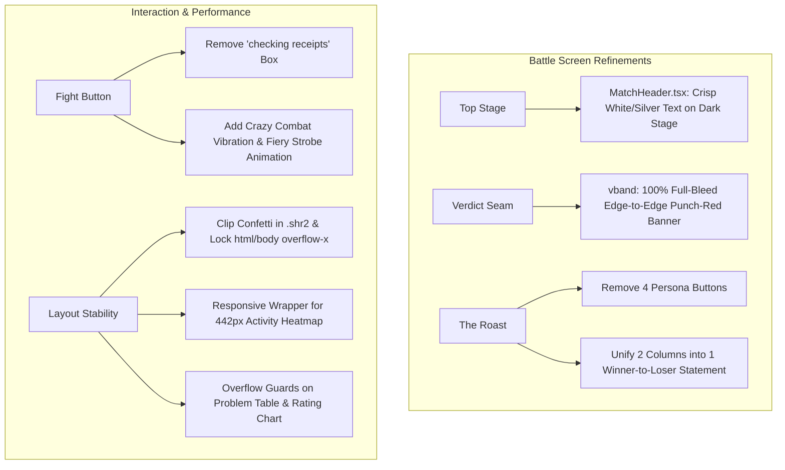

# Battle Arena Polish: Readability, Crazy Fight Animation, Full-Width Verdict & Unified Roast Plan

> **Goal:**
> 1. **Battle Screen Top Breadcrumb Readability:** Replace the unreadable dark text (`text-ink` / `text-secondary` on dark charcoal stage) in `MatchHeader.tsx` with high-contrast, crisp `#F4F4F4` and `#A3A6AE` typography on the dark `.dk.stage`.
> 2. **Energetic Fight Button Animation & Remove 'Checking Receipts':** Remove the awkward `"checking the receipts…"` banner beneath the compare form and instead animate the "Fight" button *like crazy* with a seismic combat rumble, intense flaming strobe glow, and clashing swords typography.
> 3. **Eliminate All Horizontal Scrolling:** Fix page-wide horizontal overflow caused by confetti particles in the 3D card preview (`.shr2`), the 442px activity heatmap grid (`.hm`), and missing `overflow-x: hidden` safeguards on root layouts.
> 4. **Remove 4 Persona Options in 'The Roast' Section:** Remove the top persona switcher buttons (`savage dev | VC | UFC | Hype-man`) from `RoastMoment.tsx` to streamline the section.
> 5. **Unified Winner-to-Loser Roast Statement:** Replace the side-by-side two-column split in `RoastMoment.tsx` with a single, monumental 1-2 sentence roast delivered directly from the winner's perspective roasting the loser (or draw punchline for ties).
> 6. **Full-Width Edge-to-Edge Verdict Banner:** Restore and elevate the punch-red `.vband` from a constrained 960px floating pill into a monumental full-width edge-to-edge brutalist banner spanning the entire screen between the dark stage and light receipts.

---

## 1. Problem & Root Cause Analysis

### A. Unreadable Text in Battle Top Section
- **Location:** `src/components/battle/MatchHeader.tsx` inside `.dk.stage`.
- **Problem:**
  The `.dk.stage` container has a dark charcoal/black gradient background (`#15171B` to `#242832`).
  However, `MatchHeader.tsx` renders `text-ink` (`#111214`) and `text-secondary` (`#5E6066`), causing `@ecnerwala vs @Benq` to render black-on-black and be almost invisible.
- **Fix:**
  Update `MatchHeader.tsx` with high-contrast light typography (`text-[#F4F4F4]`, `text-[#A3A6AE]`, `border-white/10`).

---

### B. "Checking Receipts" Doesn't Look Good & Fight Button Needs High-Energy Loading
- **Location:** `src/components/compare/MatchStatus.tsx` & `src/components/compare/CompareForm.tsx`.
- **Problem:**
  When clicking "Fight", an extra card with a spinning loader and `"checking the receipts…"` appears below the input bar, pushing content down and feeling clunky, while the Fight button stays static.
- **Fix:**
  1. In `MatchStatus.tsx`, return `null` for `state === "submitting"` (keep only actionable error and rate-limit alerts).
  2. In `globals.css` and `CompareForm.tsx`, add `@keyframes fight-crazy-shake` (rapid tension vibration) and `@keyframes fight-flame-strobe` (pulsing crimson fiery glow) to `.fb.is-fighting` with clashing swords icon and `FIGHTING! ⚔️` text.

---

### C. Horizontal Scrolling on Battle and Landing Pages
- **Root Causes:**
  1. Confetti particles in `.shr2` translate by `--x: 375px` and `--x: -374px`, bursting past container edges because `.shr2` lacks `overflow: hidden`.
  2. The 26-column activity heatmap grid (`.hm`) has a fixed width of $442\text{px}$, which overflows on mobile viewports ($\le 430\text{px}$).
  3. `.problem-scroll-container` lacks `overflow-x: auto`.
  4. `html` and `body` lack `overflow-x: hidden`.
- **Fix:**
  Clip `.shr2` with `overflow: hidden; max-width: 100%;`, lock `html, body` with `overflow-x: hidden; max-width: 100vw;`, wrap `.hm` in a responsive scroll container, and add `overflow-x: auto` to problem tables.

---

### D. Remove 4 Persona Options in 'The Roast' Section
- **Location:** `src/components/battle/RoastMoment.tsx`.
- **Problem:**
  The `.seg2` tab switcher with `savage dev | VC | UFC | Hype-man` clutters the section header and distracts from the core battle outcome.
- **Fix:**
  Remove `.seg2` and `PERSONA_CONFIG` tabs from `RoastMoment.tsx`. Keep the header clean with `The roast` and the monospace outcome indicator.

---

### E. Unified Winner-to-Loser Roast Statement (Not Separate Columns)
- **Location:** `src/components/battle/RoastMoment.tsx`.
- **Problem:**
  Currently, `.g2` divides the roast into two separate side-by-side columns: one for Player 1 and one for Player 2 (e.g. `● @Radewoosh: Big claims. Limited receipts.` vs `● @Um_nik: @Um_nik, legendary run...`).
  This feels disconnected and dilutes the punchline.
- **Fix:**
  Replace the two-column grid with a single, unified, high-impact roast block:
  - If there is a winner: delivers a single 1-2 sentence statement from the winner's perspective roasting the loser (e.g., `“@Um_nik, legendary run, but the gap on the scoreboard tells its own story.”` or `@Petr, the scoreboard would like a word.`).
  - If draw: delivers the unified tie roast (`“Same score. Twice the ego.”`).
  - Render with prominent brutalist typography, highlighted keywords (`.wd.mk`), winner/loser tags, and the reaction counters.

---

### F. Full-Width Edge-to-Edge Punch-Red Verdict Banner
- **Location:** `src/components/battle/BattleResult.tsx` & `src/app/globals.css`.
- **Problem:**
  The red verdict block is currently constrained inside `<div className="w">` with `max-width: 960px`, `border-radius: 12px`, floating as an isolated pill with white margins on both sides.
- **Fix:**
  - Remove the outer `<div className="w">` wrapper from around `.vband` in `BattleResult.tsx`.
  - Style `.vband` as a full-bleed edge-to-edge section (`width: 100%`) spanning from viewport edge to viewport edge.
  - Inside `.vband`, place `<div className="w">` so the text aligns perfectly with the site grid.
  - Upgrade styling: stark top/bottom borders (`border-t border-black/20`, `border-b-4 border-ink`), clean punch-red `#D82A26` background, sharp monospace `VERDICT` label, and monumental uppercase typography (`clamp(28px, 4vw, 52px)`).

---

## 2. Proposed Architecture & Changes



---

## 3. Implementation Tasks

### Task 1: Fix Breadcrumb & Top Section Text Contrast in `MatchHeader.tsx`
**Files:**
- Modify: `src/components/battle/MatchHeader.tsx`

**Details:**
```tsx
export default function MatchHeader({ vm, actions }: MatchHeaderProps) {
  return (
    <div className="flex flex-col sm:flex-row items-start sm:items-center justify-between gap-3 pb-3 border-b border-white/10">
      {/* Compact breadcrumb / matchup context */}
      <nav aria-label="Breadcrumb" className="flex items-center gap-2 text-xs font-mono flex-wrap">
        <Link
          href="/"
          className="text-[#A3A6AE] hover:text-white transition-colors font-bold uppercase tracking-wider"
        >
          the arena
        </Link>
        <span className="text-white/40 font-bold" aria-hidden="true">/</span>
        <span className="font-extrabold text-[#F4F4F4] tracking-wide">
          @{vm.p1.handle} vs @{vm.p2.handle}
        </span>
        {vm.isSample && (
          <span className="px-2 py-0.5 rounded-full bg-white/15 text-[10px] font-bold text-white uppercase tracking-wider border border-white/20">
            demo
          </span>
        )}
      </nav>

      {actions && (
        <div className="flex items-center gap-2 shrink-0">
          {actions}
        </div>
      )}
    </div>
  );
}
```

---

### Task 2: Make Verdict Block Full-Width Edge-to-Edge (`BattleResult.tsx` & `globals.css`)
**Files:**
- Modify: `src/components/battle/BattleResult.tsx`
- Modify: `src/app/globals.css`

**Details:**
1. In `BattleResult.tsx`:
   Remove `<div className="w">` wrapper from `.vband`:
   ```tsx
   {/* 2. Full-Bleed Punch-Red Verdict Banner (.vband) */}
   <section className="vband w-full select-none" aria-label="Battle verdict">
     <div className="w">
       <div className="mono">
         Verdict
       </div>
       <div className="big">
         {verdictText}
       </div>
     </div>
   </section>
   ```
2. In `globals.css`:
   Update `.vband`:
   ```css
   /* Full-Bleed Punch-Red Verdict Banner (.vband) */
   .vband {
     background: var(--or);
     width: 100%;
     max-width: 100%;
     margin: 0;
     border-radius: 0;
     padding: 24px 0 28px;
     border-top: 1px solid rgba(0, 0, 0, 0.25);
     border-bottom: 4px solid var(--ink);
     box-shadow: 0 16px 36px -10px rgba(216, 42, 38, 0.35);
     position: relative;
     z-index: 10;
   }

   .vband .big {
     font-size: clamp(26px, 3.8vw, 48px);
     line-height: 1.02;
     color: #fff;
     letter-spacing: .01em;
     word-break: break-word;
   }

   .vband .mono {
     color: rgba(255, 255, 255, 0.88);
     font: 700 12px/1 'IBM Plex Mono', monospace;
     letter-spacing: .16em;
     text-transform: uppercase;
     margin-bottom: 8px;
   }
   ```

---

### Task 3: Streamline 'The Roast' Section (Remove 4 Persona Tabs & Unify Winner Roast)
**Files:**
- Modify: `src/components/battle/RoastMoment.tsx`

**Details:**
1. Remove persona tabs (`.seg2` buttons for `savage dev | VC | UFC | Hype-man`).
2. Replace two-column `.g2` with a single unified roast from the winner's perspective:
   - Identify winner and loser handles.
   - For wins: deliver a single roast addressing the loser directly (e.g., `copy.roastText`).
   - For draws: deliver the unified tie statement (`Same score. Twice the ego.`).
   - Render in a bold, singular statement block with word animations and highlighted keywords (`.wd.mk`), followed by reaction buttons and `run it back`.

---

### Task 4: Animate Fight Button Like Crazy & Remove 'Checking Receipts' Box
**Files:**
- Modify: `src/components/compare/MatchStatus.tsx`
- Modify: `src/components/compare/CompareForm.tsx`
- Modify: `src/app/globals.css`

**Details:**
1. In `MatchStatus.tsx`:
   Return `null` for `state === "submitting"`.
2. In `globals.css`:
   Add `@keyframes fight-crazy-shake` and `@keyframes fight-flame-strobe`.
   Style `.fb.is-fighting`.
3. In `CompareForm.tsx`:
   Apply `is-fighting` class to submit button when `status === "submitting"`, showing `<Swords className="w-5 h-5 animate-spin" />` + `FIGHTING!`.

---

### Task 5: Eliminate All Page Horizontal Scrolling
**Files:**
- Modify: `src/app/globals.css`
- Modify: `src/components/battle/ActivityHeatmap.tsx`
- Modify: `src/components/battle/RatingHistoryChart.tsx`
- Modify: `src/components/battle/BattleResult.tsx`

**Details:**
1. In `globals.css`:
   - Set `overflow-x: hidden; max-width: 100vw; width: 100%;` on `html, body`.
   - Set `overflow: hidden; max-width: 100%;` on `.shr2` to clip confetti particles (`--x: 375px`).
   - Add `overflow-x: auto;` to `.problem-scroll-container`.
2. In `ActivityHeatmap.tsx`:
   Wrap `.hm` in `<div className="overflow-x-auto max-w-full pb-1 scrollbar-none">`.
3. In `RatingHistoryChart.tsx`:
   Change `overflow-visible` to `overflow-hidden` on SVG.
4. In `BattleResult.tsx`:
   Add `overflow-x-hidden` on root container.

---

## 4. Verification Plan

### Automated Tests
- Run test suite:
  ```bash
  npm test
  ```
  Ensure all 28 test files and 158 tests pass.
- Run production build:
  ```bash
  npm run build
  ```
  Verify zero TypeScript or compilation errors.

### Manual Verification
1. **Breadcrumb Contrast:**
   - Open `http://localhost:3000/battle/cf-ecnerwala-vs-benq-2504fb15-c10`.
   - Verify `the arena / @ecnerwala vs @Benq` is bright, high-contrast, and crisp against the dark stage.
2. **Full-Width Verdict Banner:**
   - Confirm the punch-red `VERDICT` banner spans 100% of the screen width edge-to-edge, with no awkward white side margins, and inner text aligned to the content grid.
3. **Streamlined Single-Statement Roast:**
   - Confirm the 4 persona buttons in "The roast" header are gone.
   - Confirm the roast is a single monumental statement roasting the loser from the winner's perspective (or a single draw statement for ties), rather than two separate columns.
4. **Crazy Fight Button Animation:**
   - Enter two handles on `http://localhost:3000/` and click "Fight".
   - Confirm "checking the receipts..." box is gone.
   - Confirm the button shakes rapidly, pulses with a flaming crimson glow, and shows `FIGHTING! ⚔️`.
5. **Zero Horizontal Scrolling:**
   - Resize browser from 1920px down to 360px on both `/` and `/battle/...`.
   - Confirm `document.documentElement.scrollWidth === document.documentElement.clientWidth` (no horizontal scrollbar).
