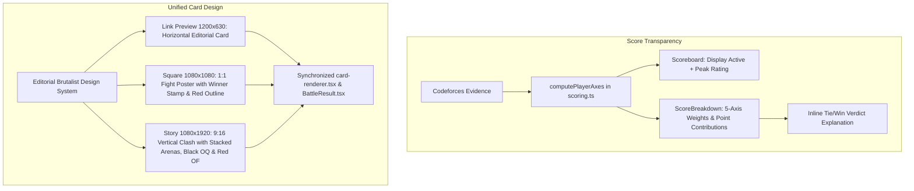

# Score Transparency, Weight Breakdown & Unified Brutalist Card Theme Plan

> **For agentic workers:** REQUIRED SUB-SKILL: Use superpowers:subagent-driven-development (recommended) or superpowers:executing-plans to implement this plan task-by-task. Steps use checkbox (`- [ ]`) syntax for tracking.

**Goal:**
1. **On-Screen Score Transparency & Weight Breakdown:** Display the full 5-axis scoring formula and weighted point contributions directly on the screen so users instantly understand why two contestants tied or why a margin occurred (e.g., how Ecnerwala's +2.2 pts in Volume balanced Benq's +1.8 pts in Velocity). Show both **Active Rating** and **All-Time Peak Rating** on the scoreboard banner (`3,097 rating (peak 3,844)` vs `3,676 rating (peak 3,857)`).
2. **Unified Editorial Brutalist Theme Across All 3 Cards:** Bring the beloved editorial brutalist style of the **Link Preview** (`.og2` / stark white card, heavy typography, black `WINNER` stamp, red outline loser typography, pitch-black `.oq` quote bar, and punch-red `.of` footer) into **Story (1080x1920)** and **Square (1080x1080)** formats across both server PNG generation (`card-renderer.tsx`) and in-page DOM previews (`BattleResult.tsx`, `globals.css`).

---

## 1. Problem & Root Cause Analysis

### A. Why Equal Scores Felt Mysterious (Ecnerwala 83 vs Benq 83)
- In the current UI:
  - The scoreboard only displays **current active rating** (`3,097` vs `3,676`).
  - To the user, a 579 rating point gap looks gigantic, making an `83 – 83` tie seem contradictory or arbitrary.
  - The scoring engine actually uses **all-time peak rating** (`maxRating`: `3,844` vs `3,857`) for Contest Peak, where both legends hit the 3,500 ceiling (100 pts).
  - Ecnerwala won **Solve Volume** (635 vs 533 solves $\rightarrow$ `12.8` vs `10.6 pts`, **+2.2 pts Ecnerwala**).
  - Benq won **Recent Velocity** (74 vs 55 recent solves $\rightarrow$ `7.4` vs `5.6 pts`, **+1.8 pts Benq**).
  - Both players scored 100 on **Algorithmic Grit** (30 pts) and **Topic Breadth** (10 pts).
  - The weighted sums were `83.35` vs `82.95`, which both round to **83**.
- **Fix:**
  - In `Scoreboard.tsx`, display both active and peak ratings: `3,097 rating (peak 3,844)` vs `3,676 rating (peak 3,857)`.
  - Add an on-screen **Score & Weights Breakdown Card** directly in the battle view displaying:
    - The 5 weights: **Grit 30%**, **Contest Peak 25%**, **Volume 20%**, **Velocity 15%**, **Breadth 10%**.
    - Side-by-side points table showing the exact contribution of each axis.
    - An explicit verdict explanation callout (e.g., *"Tie breakdown: Ecnerwala's edge in total solves (+2.2 pts) balanced Benq's recent contest activity (+1.8 pts), with identical peak rating (3,844 vs 3,857) and maximum algorithmic grit."*).

### B. Why Story and Square Did Not Follow the Link Preview Theme
- In `card-renderer.tsx` and `BattleResult.tsx`:
  - The Link Preview (`og` and `.og2`) uses the iconic Trashtalk fight paper theme: off-white card, stark black `#111214` borders, bold editorial typography, solid black `.ow` `WINNER` stamp, red outline runner-up typography (`-webkit-text-stroke: 2px #D82A26`), pitch-black quote block (`.oq`), and punch-red brand footer (`.of`).
  - However, Story and Square were implemented with saturated solid blue (`#304BFF`) and orange (`#FF5A2A`) card slabs with monograms, which completely broke away from the editorial newspaper/fight poster aesthetic of the rest of the app.
- **Fix:**
  - Redesign both **Story (1080x1920)** and **Square (1080x1080)** to use the exact same editorial brutalist design language:
    - High-contrast off-white card canvas.
    - Stark black `#111214` header bar with `TrashTalk` logo, platform badge, and date.
    - Winner gets solid black type + crisp black `WINNER` stamp.
    - Runner-up gets red outline typography (`-webkit-text-stroke`).
    - Monumental fight score numerals.
    - Monospace rank & rating metadata (displaying both active and peak rating).
    - Pitch-black `.oq` quote bar (`“Outcome Line”`).
    - Punch-red `.of` footer bar with `Think you can beat them?` and `trashtalk.dev`.

---

## 2. Proposed Changes



---

## 3. Implementation Tasks

### Task 1: Add Peak Rating & Active Rating to Scoreboard Banner
**Files:**
- Modify: `src/components/battle/Scoreboard.tsx`
- Modify: `src/lib/battle/presentation.ts`

**Details:**
1. In `src/lib/battle/presentation.ts`:
   - Ensure `BattlePlayerViewModel` exposes both `rating` and `maxRating`:
     ```ts
     rating?: number;
     maxRating?: number;
     ```
2. In `src/components/battle/Scoreboard.tsx`:
   - Update metadata line under player handles:
     ```tsx
     <span>
       {vm.p1.rating ? `${vm.p1.rating.toLocaleString()} rating` : ""}
       {vm.p1.maxRating && vm.p1.maxRating !== vm.p1.rating
         ? ` (peak ${vm.p1.maxRating.toLocaleString()})`
         : ""}
       {" · "}{vm.p1.score} pts
     </span>
     ```
   - For Ecnerwala & Benq: renders `3,097 rating (peak 3,844) · 83 pts` vs `3,676 rating (peak 3,857) · 83 pts`.

---

### Task 2: Build On-Screen Score & Weights Breakdown Component
**Files:**
- Create: `src/components/battle/ScoreBreakdown.tsx`
- Modify: `src/components/battle/BattleResult.tsx`
- Modify: `src/app/globals.css`

**Details:**
1. Create `ScoreBreakdown.tsx` presenting the transparent 5-axis math:
   - Header: `HOW THE SCORE WAS DECIDED` + weighted formula chip.
   - Table displaying:
     - **Axis** (with explicit weight badge: `30%`, `25%`, `20%`, `15%`, `10%`).
     - **P1 Metric & Points Contribution** (e.g., `Grit: 100 → 30.0 pts`).
     - **P2 Metric & Points Contribution** (e.g., `Grit: 100 → 30.0 pts`).
     - **Net Advantage Column** (e.g., `+2.2 pts Ecnerwala (Volume)`, `+1.8 pts Benq (Velocity)`).
   - Bottom Total Calculation:
     - `Ecnerwala: 30.0 + 25.0 + 12.8 + 5.6 + 10.0 = 83.4 → 83 pts`
     - `Benq: 30.0 + 25.0 + 10.6 + 7.4 + 10.0 = 83.0 → 83 pts`
   - Explicit Verdict Context box:
     - For ties: explains which axes balanced each other out.
     - For wins: explains the decisive winning axis.
2. Integrate `ScoreBreakdown` in `BattleResult.tsx` right alongside the radar/metrics section (`skill check.` / `the receipts.`).

---

### Task 3: Redesign Story & Square in `card-renderer.tsx` to Match the "Link Preview" Theme
**Files:**
- Modify: `src/lib/share/card-renderer.tsx`

**Details:**
1. **Story Card (`1080 x 1920`, 9:16):**
   - Replace saturated blue/orange blocks with the editorial brutalist theme:
     - **Outer Frame:** High-contrast off-white canvas with stark white fight card, 5px black border, and 12px drop shadow.
     - **Header Bar:**
       - `trashtalk.` in heavy brutalist type (56px) + `CODEFORCES` pill + `STORY` pill + formatted date.
     - **Player 1 Arena Block:**
       - Winner badge: Stark black slab with white text `WINNER (+7 PTS)` if won, or `TIE` if draw.
       - Handle: Massive bold 64px black typography (`@ECNERWALA`).
       - Meta: Monospace rank & ratings: `LEGENDARY GRANDMASTER · 3,097 (PEAK 3,844)`.
       - Giant score: `83` in monumental brutalist numerals (180px).
     - **Central Clash Divider:**
       - Editorial `VS` slash with double black rule.
     - **Player 2 Arena Block:**
       - Handle: Red outline typography (`-webkit-text-stroke: 3px #D82A26; color: transparent;`) if loser, or solid black if winner/draw (`@BENQ`).
       - Meta: Monospace rank & ratings: `LEGENDARY GRANDMASTER · 3,676 (PEAK 3,857)`.
       - Giant score: `83` in monumental brutalist numerals (180px).
     - **Roast Quote Strip (`.oq`):**
       - Pitch-black solid ink slab (`#111214`) with white text:
         - Red dot + outcome line: `EVEN MATCH · 0 PTS APART`
         - Punchy roast: `Same score. Twice the ego.` (36px bold).
     - **Brand Footer Bar (`.of`):**
       - Punch-red brutalist slab (`#D82A26`) with white text:
         - Left: `Think you can beat them?` (26px bold)
         - Right: `trashtalk.dev` (24px monospace).

2. **Square Card (`1080 x 1080`, 1:1):**
   - Apply the same editorial brutalist theme to the 1:1 square canvas:
     - Stark white card with 4px black border and 10px shadow.
     - Top header (`trashtalk.` + platform pill + `SQUARE` + date).
     - Split 50/50 combatant arena:
       - Left: P1 handle (bold black or outline), winner stamp, rank, rating with peak, giant 130px score.
       - Center: Angular `VS` badge.
       - Right: P2 handle (bold black or outline), winner stamp, rank, rating with peak, giant 130px score.
     - Pitch-black `.oq` quote bar with outcome line and roast punchline.
     - Punch-red `.of` footer bar with `Think you can beat them?` and canonical URL.

3. **OG Card (`1200 x 630`, 1.91:1):**
   - Retain and polish the existing horizontal layout, ensuring peak ratings are displayed in the metadata.

---

### Task 4: Upgrade In-Page DOM Previews (`BattleResult.tsx` & `globals.css`)
**Files:**
- Modify: `src/components/battle/BattleResult.tsx`
- Modify: `src/app/globals.css`

**Details:**
1. In `src/components/battle/BattleResult.tsx`:
   - Update `.st9` and `.sq9` DOM structure to use the editorial brutalist elements:
     - Header `.oh`: `TrashTalk`, `Codeforces · Story` / `Square`.
     - Matchup arenas with `.ow` winner stamp, bold/outline handles, rank, active rating and peak rating.
     - Pitch-black quote bar `.oq`.
     - Punch-red footer `.of`.
2. In `src/app/globals.css`:
   - Refactor `.st9` and `.sq9` CSS to share the editorial tokens with `.og2` (crisp white background, black borders, red outline text, pitch-black quote bar, red CTA strip).

---

### Task 5: Automated & Manual Verification
1. Run full test suite:
   ```bash
   npm test
   ```
   Verify all 28 test suites and 158 tests pass.
2. Run build:
   ```bash
   npm run build
   ```
   Confirm 0 TypeScript/compilation errors.
3. Generate fresh card PNGs via `/api/og` for story, square, and og.
4. Verify on `http://localhost:3000/battle/cf-ecnerwala-vs-benq-2504fb15-c10` and `http://localhost:3000/battle/cf-tourist-vs-petr-legendary`:
   - Confirm active rating + peak rating are visible.
   - Confirm score & weights breakdown table renders clearly with weights and point deltas.
   - Confirm all three card formats (Link Preview, Story, Square) share the high-contrast editorial brutalist visual identity.
