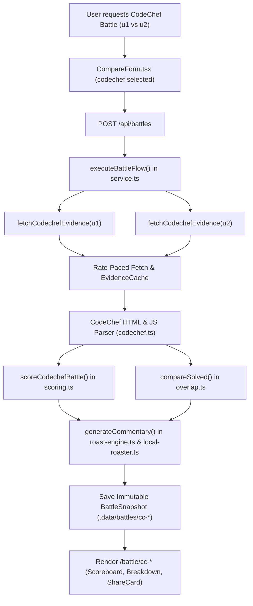

# CodeChef Platform Integration Implementation Plan

> **For agentic workers:** REQUIRED SUB-SKILL: Use `superpowers:subagent-driven-development` (recommended) or `superpowers:executing-plans` to implement this plan task-by-task. Steps use checkbox (`- [ ]`) syntax for tracking.

**Goal:** Integrate CodeChef as a fully supported, first-class competitive programming platform in TrashTalk 2.0, featuring resilient rate-paced data ingestion (handling modern and old rating eras, partial solve itemization, and unrated/inactive profiles), calibrated deterministic 5-axis algorithmic scoring (v2.0.0), problem overlap with coverage disclaimers, hilarious chef/kitchen-themed brutalist roasts, social share cards, and full web UI battle orchestration.

**Architecture:** Extend TrashTalk's platform adapter layer (`PlatformAdapter`), contracts, and battle pipeline to CodeChef. Build a resilient extraction pipeline (`fetchCodechefEvidence`) that scans embedded JavaScript arrays (`all_rating`, graph data) and DOM elements, normalizes modern vs. old rating eras, computes weighted 5-axis scores with CodeChef star/division calibration, preserves the strict 30/25/20/15/10 scoring weights, generates verdict-guarded commentary, and integrates with the existing Next.js 15 UI and Satori card renderer.

**Tech Stack:** Next.js 15 (App Router), TypeScript (Strict), Zod, `node-html-parser`, Vitest 5.0, Tailwind CSS, Satori + Resvg.

**Spec:** User specification and field notes based on public CodeChef profile inspection (`akulsareen`), covering two rating eras, incomplete problem lists, unrated/provisional DSA edge cases, and 5-axis calibration.

---

## Global Constraints

- **Scoring Weight Integrity:** The 5-axis mathematical formula weights ($30\%$ Grit, $25\%$ Contest Peak, $20\%$ Volume, $15\%$ Velocity, $10\%$ Breadth) MUST remain strictly identical across all platforms.
- **Immutable Snapshot Guarantee:** Battles are write-once, read-many; snapshots stored in `.data/battles/` are immutable and must never be mutated.
- **Contradiction Guard:** Generated commentary, local punchlines, and roasts MUST strictly match `snapshot.verdict.winnerHandle`. Losers must never be crowned winners in prose.
- **Offline & Hermetic Tests:** Automated Vitest test suites MUST run completely offline with zero unmocked network requests, using saved fixtures in `tests/fixtures/codechef/`.
- **Zero Layout Breakage:** No horizontal scrolling (`overflow-x`) on mobile viewports ($\le 360\text{px}$).
- **Verification Gate:** `npm test` (all suites) and `npm run build` must pass with zero errors.

---

## Review Focus

1. **Two Rating Eras:** The adapter extracts both "Current" and "Old" rating series (the old era ended on 2022-12-20) and uses the maximum across both eras and header text as `maxRating` so older legendary peaks are not erased.
2. **Incomplete Solve Itemization:** The public profile lists ~200 contest solves by name while displaying `Total Problems Solved: 359`. The engine stores `totalSolved = 359` for the Volume score, stores `listedCount = 200` for Overlap DNA, and marks `isCompleteSolveList: false` with an explicit UI disclaimer.
3. **Unrated & Inactive DSA Handling:** Handles users with zero contests or `"NA"`/`"Inactive"` DSA ratings gracefully using typed `null` instead of `0` or `NaN`.
4. **Resilient Rate-Pacing & Error Classification:** Enforces a 400ms throttle via `codechefThrottler` with an honest User-Agent (`TrashTalk/2.0`). Correctly classifies 404 as `not_found`, 429 as `rate_limited`, and Cloudflare blocks as `unavailable`.
5. **Brutalist Brand Expression:** Features CodeChef's warm rust/orange theme (`#ED714B`), displays stars (`★★★★★ 5★`) and Division pills (`Div 1`), and delivers kitchen/chef/star-tier themed roasts.

---

## User Review Required

> [!IMPORTANT]
> **Dependency Addition:** We recommend installing `node-html-parser` (zero-dependency, lightweight, fast HTML DOM parser) to parse CodeChef's nested contest tables and profile headers reliably without fragile multi-line regexes.

> [!NOTE]
> **Problem Overlap Coverage:** Because CodeChef's public profile only lists contest solves (and omits practice-only solves), problem overlap and exclusive solves will be marked with `isDefinitive: false`. The UI will display a coverage note: *"Problem overlap computed from public contest solves; practice-only solves are omitted on CodeChef profiles."*

---

## Open Questions

> [!TIP]
> **Heatmap & Recent Activity AJAX Endpoints:** Once Step 1 recon is performed with Chrome DevTools or `curl`, any specific AJAX endpoints discovered (e.g., `/users/submissions/<handle>` or heatmap sub-routes) will be wired into `fetchCodechefEvidence`. In the initial implementation, contest timestamps and submission stats provide fallback velocity calculation.

---

## Proposed Changes



---

### Component 1: Reconnaissance Tool & Test Fixtures

#### [NEW] `scripts/codechef-dump.ts`
- Standalone CLI utility to fetch, inspect, and output complete extracted JSON for any CodeChef handle.
- Supports saving raw HTML and extracted payloads directly to `tests/fixtures/codechef/`.
- Usage: `npx tsx scripts/codechef-dump.ts akulsareen --save-fixture`

#### [NEW] `tests/fixtures/codechef/akulsareen.html`
- Captured sample HTML fixture for `akulsareen` (5★, Div 1, peak 2260, 54 contests, 359 solves).

#### [NEW] `tests/fixtures/codechef/unrated.html` & `tests/fixtures/codechef/not-found.html`
- Fixtures for edge-case testing: unrated user (0 contests, 0 solves) and 404 user not found.

---

### Component 2: Contracts, Types & Rate-Paced HTTP

#### [MODIFY] `src/lib/platforms/contracts.ts`
- Define `CodechefProfile`:
  ```ts
  export interface CodechefProfile {
    handle: string;
    displayName?: string;
    avatarUrl?: string;
    countryName?: string;
    countryCode?: string;
    userType?: "Student" | "Professional";
    organisation?: string;
    proPlan?: string;
    rating?: number;
    highestRating?: number;
    stars?: number;
    starString?: string; // e.g. "5★"
    division?: 1 | 2 | 3 | 4 | null;
    globalRank?: number | null;
    countryRank?: number | null;
    contestsParticipated: number;
    ratedContestsCount?: number;
    totalSolved: number;
    listedSolvedCount: number;
    dsaRating?: number | null;
    dsaHighestRating?: number | null;
    dsaGlobalRank?: number | "Inactive" | null;
    dsaCountryRank?: number | "Inactive" | null;
  }
  ```
- Define `CodechefEvidence`:
  ```ts
  export interface CodechefEvidence {
    platform: "codechef";
    handle: string;
    status: EvidenceStatus;
    fetchedAt: string;
    profile?: CodechefProfile;
    contestHistory?: ContestRatingChange[];
    solvedProblems?: SolvedProblem[];
    submissionCalendar?: string;
    recent180dSubmissions?: number;
    recent180dActiveDays?: number;
    coverage: EvidenceCoverage;
    error?: string;
  }
  ```
- Extend `PlatformEvidence`:
  ```ts
  export type PlatformEvidence = CodeforcesEvidence | LeetcodeEvidence | CodechefEvidence;
  ```

#### [MODIFY] `src/lib/platforms/http.ts`
- Add `codechefThrottler`: Request throttler with 400ms delay.
- Add `CODECHEF_HEADERS`:
  ```ts
  export const CODECHEF_HEADERS = {
    "User-Agent": "TrashTalk/2.0 (+https://trashtalk.dev; contact@trashtalk.dev)",
    "Accept": "text/html,application/xhtml+xml,application/xml;q=0.9,*/*;q=0.8",
    "Accept-Language": "en-US,en;q=0.9",
  };
  ```

---

### Component 3: CodeChef Extraction Pipeline & Adapter

#### [MODIFY] `src/lib/platforms/codechef.ts`
- Rewrite `codechef.ts` with production-grade `fetchCodechefEvidence(handle: string, context?: FetchContext): Promise<CodechefEvidence>`:
  - **Handle validation:** Permissive `/^[A-Za-z0-9_.]{3,30}$/`, rejects path traversal (`..`, `/`, `\`).
  - **Error classification:**
    - 404 / `"Could not find page"` / `"User not found"` $\rightarrow$ `status: "not_found"`.
    - 429 $\rightarrow$ `status: "rate_limited"`.
    - Cloudflare challenge / 403 $\rightarrow$ `status: "unavailable"`.
  - **Embedded JavaScript array scanner:**
    - Scans for `var all_rating = [...]` or rating graph JSON blocks.
    - Extracts contest code, name, rating, delta, rank, and "cheated in" flag.
    - Separates modern and old rating eras (split by date `2022-12-20`).
  - **DOM Parsing (`node-html-parser`):**
    - Extracts avatar URL, display name (stripping star prefix `5★`).
    - Extracts current rating (`2103`), highest rating (`2260`), division (`Div 1`).
    - Derives stars ($1\text{★} \dots 7\text{★}$) from rating thresholds and cross-checks with text.
    - Extracts `Total Problems Solved: 359` as `totalSolved`.
    - Extracts contest-grouped problem names and codes under "Fully Solved".
    - Computes `listedSolvedCount` and sets `isCompleteSolveList = listedSolvedCount >= totalSolved`.
  - **180-Day Velocity:**
    - Calculates recent solves and active contest participation within 180 days.

---

### Component 4: Deterministic 5-Axis Scoring & Problem Overlap

#### [MODIFY] `src/lib/battle/scoring.ts`
- Implement `computeCodechefPlayerAxes(evidence: CodechefEvidence): PlayerScore`:
  1. **Algorithmic Grit (30%):**
     - Calibrated by peak rating, star tier, and division depth:
       - 7★ (2500+ rating) / Div 1: Grit baseline 85–100.
       - 5★–6★ (2000–2499) / Div 1: Grit baseline 65–84.
       - 3★–4★ (1600–1999) / Div 2–3: Grit baseline 35–64.
       - 1★–2★ (< 1600) / Div 3–4: Grit baseline 10–34.
  2. **Contest Peak (25%):**
     - Highest rating evaluated across both modern and old eras relative to 3,200 ceiling:
       $\text{contestPeak} = \min(100, \text{round}((\text{maxRating} / 3200) \times 100))$.
  3. **Solve Volume (20%):**
     - Total problems solved from authoritative `profile.totalSolved` counter:
       $\text{solveVolume} = \min(100, \text{round}((\text{totalSolved} / 1000) \times 100))$.
  4. **Recent Velocity (15%):**
     - Solves and active contest appearances within the last 180 days.
  5. **Topic Breadth (10%):**
     - Unique problem categories and contest formats participated in.
- Implement `scoreCodechefBattle(p1: CodechefEvidence, p2: CodechefEvidence): BattleVerdict`.
- Wire `scoreBattle(platform, p1, p2)` to dispatch `scoreCodechefBattle` when `platform === "codechef"`.

#### [MODIFY] `src/lib/battle/overlap.ts`
- Support `compareSolved` for CodeChef problem lists.
- Normalize problem IDs as `CC:<problem_code>`.
- Set `isDefinitive: false` for exclusive problem lists when `isCompleteSolveList` is false, ensuring honest display.

---

### Component 5: Roasting Engine, Commentary & Persona Copy

#### [MODIFY] `src/lib/ai/local-roaster.ts`
- Implement CodeChef local commentary generator:
  - References star tiers: 7★ Master Chef vs 1★ Line Cook.
  - Division roasts: "Living comfortably in Div 4" vs "Fighting for survival in Div 1".
  - Long Challenge roasts: "Spent 10 days on a Long Challenge with 15 StackOverflow tabs open".
  - Editorial peeking & kitchen puns ("completely cooked in the contest").
  - "Cheated in" detection: If raw history has an infraction, delivers a savage disqualification roast.

#### [MODIFY] `src/lib/ai/roast-engine.ts`
- Update Gemini system prompt instructions with CodeChef domain vocabulary (Stars, Divisions, Cook-Off, Lunchtime, Starters, Long Challenge, Chef hats).

#### [MODIFY] `src/lib/battle/short-roast.ts`
- Add punchlines tailored for CodeChef battles:
  - *"Cooked to a crisp: @winner served @loser a 5-star masterclass."*

---

### Component 6: Battle Service, Prepared Demos, & Validation

#### [MODIFY] `src/lib/battle/validation.ts`
- Update `CreateBattleRequestSchema.platform` to include `"codechef"`:
  ```ts
  platform: z.enum(["codeforces", "leetcode", "codechef"]).default("codeforces")
  ```

#### [MODIFY] `src/lib/battle/service.ts`
- Add `platform === "codechef"` flow to `executeBattleFlow`:
  - Fetches `fetchCodechefEvidence` concurrently for `u1` and `u2`.
  - Computes `scoreCodechefBattle`.
  - Computes `compareSolved`.
  - Generates commentary.
  - Builds canonical ID: `cc-${u1}-vs-${u2}-${uuid}`.
  - Persists snapshot to `.data/battles/`.
- Wire prepared offline battle into `getBattleSnapshot`.

#### [MODIFY] `src/lib/demo/prepared-battles.ts`
- Add `PREPARED_AKULSAREEN_VS_GENNADY`:
  - Canonical ID: `cc-akulsareen-vs-gennady-legendary`.
  - Realistic snapshot with 5★ (`akulsareen`) vs 7★ (`gennady`), complete with scores, radar axes, and roasts.

#### [MODIFY] `src/lib/battle/presentation.ts`
- Format CodeChef subtitle:
  - Displays stars and division: e.g. `5★ (Div 1) · Global #563 (Peak 2260)`.

---

### Component 7: Platform Registry, Web UI & Social Share Cards

#### [MODIFY] `src/lib/platforms/registry.ts`
- Switch CodeChef status from `"planned"` to `"live"`:
  ```ts
  codechef: {
    id: "codechef",
    label: "CodeChef",
    status: "live",
    availabilityLabel: "live",
    ...
  }
  ```

#### [MODIFY] `src/components/compare/CompareForm.tsx`
- Enable CodeChef platform tab.
- Add quick one-click battle button: `akulsareen vs gennady` linking to `/battle/cc-akulsareen-vs-gennady-legendary`.
- Provide CodeChef handle placeholder hints.

#### [MODIFY] `src/components/battle/Scoreboard.tsx` & `src/components/battle/BattleResult.tsx`
- Display CodeChef star badges (`★★★★★ 5★`) and Division pills alongside ratings.

#### [MODIFY] `src/lib/share/card-renderer.tsx`
- Ensure social cards (OG, Square, Story) render CodeChef branding, star rating badges, and `#ED714B` rust accent.

---

## Detailed Task Breakdown

### Task 1: Package Dependency, Contracts, HTTP Client & Recon Tool

**Files:**
- Modify: `package.json`
- Modify: `src/lib/platforms/contracts.ts`
- Modify: `src/lib/platforms/http.ts`
- Create: `scripts/codechef-dump.ts`
- Create: `tests/fixtures/codechef/akulsareen.json`

- [ ] **Step 1: Install `node-html-parser`**
  Add `node-html-parser` to dependencies.
- [ ] **Step 2: Add CodeChef contracts to `contracts.ts`**
  Define `CodechefProfile`, `CodechefEvidence`, and update `PlatformEvidence`.
- [ ] **Step 3: Add `codechefThrottler` and `CODECHEF_HEADERS` in `http.ts`**
  Configure 400ms throttle and honest User-Agent headers.
- [ ] **Step 4: Create `scripts/codechef-dump.ts` & fixture files**
  Build extraction script and save offline sample fixtures in `tests/fixtures/codechef/`.

---

### Task 2: CodeChef Adapter & HTML/JS Parser

**Files:**
- Modify: `src/lib/platforms/codechef.ts`
- Create: `tests/unit/platforms/codechef.test.ts`

- [ ] **Step 1: Write unit tests for CodeChef adapter**
  Create `tests/unit/platforms/codechef.test.ts` testing:
  - 404 user not found handling (`status: "not_found"`).
  - 429 rate limit handling (`status: "rate_limited"`).
  - Parsing of `akulsareen` fixture: rating 2103, highest 2260, 5★, Div 1, Global rank 563, Country rank 403, 54 contests, 359 total solved, listed solved count, inactive DSA rating.
  - Two-era rating parsing (picks maximum across old and current eras).
  - Username cleanup (strips `5★` prefix).
- [ ] **Step 2: Run tests to verify they fail**
  Verify test suite runs and catches missing implementation.
- [ ] **Step 3: Implement `fetchCodechefEvidence` in `codechef.ts`**
  Implement HTML DOM parsing, embedded JS variable extraction, and 180-day velocity calculation.
- [ ] **Step 4: Run tests to verify they pass**
  Ensure all adapter unit tests pass green.

---

### Task 3: Deterministic 5-Axis Scoring & Overlap Engine

**Files:**
- Modify: `src/lib/battle/scoring.ts`
- Modify: `src/lib/battle/overlap.ts`
- Create: `tests/unit/battle/codechef-scoring.test.ts`

- [ ] **Step 1: Write scoring unit tests**
  Create `tests/unit/battle/codechef-scoring.test.ts` testing:
  - Strict 30/25/20/15/10 formula compliance.
  - Star tier and division calibration for Algorithmic Grit.
  - Old vs modern peak rating selection.
  - Authoritative total solved volume vs listed DOM items.
  - Unrated user handling (sensible floors, zero division prevention).
  - Draw determination on equal scores.
- [ ] **Step 2: Run tests to verify they fail**
- [ ] **Step 3: Implement `computeCodechefPlayerAxes` & `scoreCodechefBattle`**
- [ ] **Step 4: Run tests to verify they pass**

---

### Task 4: Roasting Engine, Commentary & Persona Copy

**Files:**
- Modify: `src/lib/ai/local-roaster.ts`
- Modify: `src/lib/ai/roast-engine.ts`
- Modify: `src/lib/battle/short-roast.ts`
- Create: `tests/unit/ai/codechef-roaster.test.ts`

- [ ] **Step 1: Write unit tests for CodeChef roaster**
  Verify local roaster delivers kitchen/star-tier commentary without contradicting the winner verdict.
- [ ] **Step 2: Implement CodeChef roasts in `local-roaster.ts` and update `roast-engine.ts`**
- [ ] **Step 3: Run tests to verify they pass**

---

### Task 5: Battle Service, Prepared Demos & Validation

**Files:**
- Modify: `src/lib/battle/validation.ts`
- Modify: `src/lib/battle/service.ts`
- Modify: `src/lib/demo/prepared-battles.ts`
- Modify: `src/lib/battle/presentation.ts`
- Create: `tests/integration/codechef-battle.test.ts`

- [ ] **Step 1: Write integration test for CodeChef battle lifecycle**
  Test offline prepared demo retrieval (`cc-akulsareen-vs-gennady-legendary`) and mocked battle flow.
- [ ] **Step 2: Update `validation.ts` to accept `"codechef"`**
- [ ] **Step 3: Implement `platform === "codechef"` in `service.ts`**
- [ ] **Step 4: Add `PREPARED_AKULSAREEN_VS_GENNADY` in `prepared-battles.ts`**
- [ ] **Step 5: Run integration tests to verify they pass**

---

### Task 6: Platform Registry, Web UI & Social Share Cards

**Files:**
- Modify: `src/lib/platforms/registry.ts`
- Modify: `src/components/compare/CompareForm.tsx`
- Modify: `src/components/battle/Scoreboard.tsx`
- Modify: `src/lib/share/card-renderer.tsx`
- Modify: `tests/unit/platforms/registry.test.ts`

- [ ] **Step 1: Enable `"live"` status for CodeChef in `registry.ts`**
- [ ] **Step 2: Add CodeChef shortcuts and form support in `CompareForm.tsx`**
- [ ] **Step 3: Add CodeChef stars (`★★★★★`) display in `Scoreboard.tsx`**
- [ ] **Step 4: Verify social share card rendering with CodeChef branding**
- [ ] **Step 5: Run all tests and production build**

---

## Verification Plan

### Automated Tests
Run all Vitest test suites to ensure 100% test pass rate with zero regressions:
```bash
# Run unit and integration tests
npm test

# Run specific CodeChef test suites
npx vitest run tests/unit/platforms/codechef.test.ts
npx vitest run tests/unit/battle/codechef-scoring.test.ts
npx vitest run tests/integration/codechef-battle.test.ts

# Run production build and typecheck
npm run build
```

### Manual Verification
1. **Offline Demo Check:** Navigate to `/battle/cc-akulsareen-vs-gennady-legendary` and confirm the dark stage, warm rust accents (`#ED714B`), star ratings (`5★` vs `7★`), division badges, radar chart, and brutalist roast render crisply.
2. **Landing Page Interaction:** Select the "CodeChef" chip on the landing page, click the quick battle shortcut, and confirm the battle form pre-fills and executes properly.
3. **Responsive & Mobile Viewport:** Inspect at 360px width to ensure no horizontal overflow occurs across the scoreboard, problem overlap table, and verdict banner.
4. **Social Share Cards:** Check `/api/og` rendering for a CodeChef snapshot across OG (1200×630), Square (1080×1080), and Story (1080×1920) formats.
